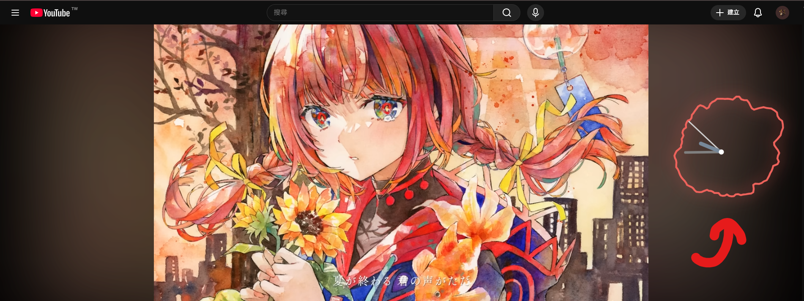

# Virtual Music Clock

A small always-on-top analog clock for your Windows desktop whose outer ring dances to the music you are playing. Run it, play anything, and the clock's ring swells and shifts color with the sound.



- **Reacts to sound**: a spectrum ring around the clock expands and contracts with your system audio.
- **Color follows the bass**: the ring moves from green to cyan to deep blue as the low end gets louder.
- **Smooth motion**: spectrum values are eased between frames, so the ring flows instead of jittering.
- **Stays out of the way**: a transparent, borderless, always-on-top window that can be made click-through from the tray menu.

A newer particle version of this clock lives in [swarm-clock](https://github.com/cholateio/swarm-clock).

## How it works

```
System audio (Stereo Mix or mic) ──► hidden audio window: FFT
        └─► WebSocket 127.0.0.1:8080 ──► clock window: ring + hands
```

The audio is analyzed in a hidden window inside the app and only spectrum numbers reach the clock window; nothing is recorded or sent over the internet.

## Install

Needs Windows and Node.js 22.12 or newer. The clock listens to what your PC plays through the Windows **Stereo Mix** device, or to a microphone if you have no Stereo Mix.

1. Turn on Stereo Mix: **Sound settings → Recording** (or **More sound settings → Recording**), right-click an empty area, choose **Show Disabled Devices**, then right-click **Stereo Mix** and choose **Enable**. Make it the default recording device.
2. In a terminal, run `npm install`, then `npm run build`. The installer is written to the `release` folder.
3. Run the installer and start **Virtual Music Clock**. Drag the clock where you want it, then right-click its tray icon and choose **Lock (mouse pass-through)**.

To try it without installing, run `npm run start:all`.

## Privacy & security

Audio never leaves your machine. The app reads it from the default recording device, turns it into spectrum numbers in memory, and sends only those numbers to its own clock window over a WebSocket bound to `127.0.0.1`, so other computers cannot connect. The socket also rejects any connection whose Origin is not the app itself, so web pages in your browser cannot read it. Microphone permission is granted only to the app's own pages, for audio only. Nothing is saved or uploaded.

## License

[MIT](LICENSE)
